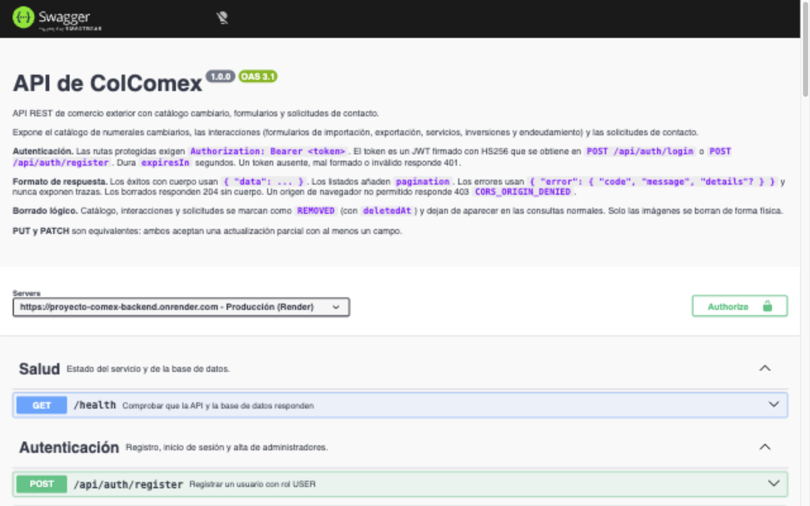

# ColComex — API (backend)

API REST de comercio exterior hecha con Node.js, Express 5, TypeScript, Prisma 6 y PostgreSQL. Permite consultar el catálogo de numerales cambiarios, diligenciar formularios (importaciones, exportaciones, servicios, inversiones y endeudamiento) y enviar solicitudes de contacto. Tiene autenticación JWT y dos roles: `ADMIN` (administra el catálogo y revisa todo) y `USER` (gestiona sus propios formularios y solicitudes). El frontend consume esta API desde su propio repositorio.

## Enlaces

| Recurso                                | Enlace                                                |
| -------------------------------------- | ----------------------------------------------------- |
| API desplegada (Render)                | https://proyecto-comex-backend.onrender.com           |
| Documentación interactiva (Swagger UI) | https://proyecto-comex-backend.onrender.com/api/docs/ |
| Contrato OpenAPI 3.1                   | [docs/openapi.yaml](docs/openapi.yaml)                |
| Frontend desplegado (Vercel)           | https://proyecto-comex-frontend-7sju.vercel.app       |
| Repositorio del backend                | https://github.com/cindy1204/proyecto-comex-backend   |
| Repositorio del frontend               | https://github.com/cindy1204/proyecto-comex-frontend  |

Integrantes del equipo: **Miguel Cárdenas** y **Cindy Bohorquez**.

## Reparto del trabajo

| Componente          | Responsabilidades                                                                                                                                           |
| ------------------- | ----------------------------------------------------------------------------------------------------------------------------------------------------------- |
| Backend (este repo) | API REST, autenticación y roles, validación de formularios, persistencia con Prisma y PostgreSQL, migraciones, seed, subida de imágenes y contrato OpenAPI. |
| Frontend            | Interfaz Next.js, navegación, sesión en el cliente, formularios, catálogo, solicitudes y descarga de los formularios diligenciados.                         |

## Arquitectura

Arquitectura en cuatro capas: las dependencias apuntan hacia el dominio y todo se ensambla en un único punto (`src/interface/container.ts`). Los controladores no tocan Prisma; llaman a casos de uso que dependen solo de interfaces del dominio, por lo que las pruebas inyectan repositorios en memoria.

```
src/
  domain/          modelos y contratos (repositorios, hash, token, almacenamiento de archivos)
  application/     casos de uso, errores de aplicación y reglas de los formularios
  infrastructure/  DTOs (Zod), repositorios Prisma, bcrypt, JWT, almacenamiento de imágenes, configuración
  interface/       controladores, routers Express, middlewares, app y contenedor
  server.ts        arranque y apagado ordenado
prisma/            esquema, migraciones y seed
tests/             unit/ (casos de uso, middlewares, JWT, repositorios) y http/ (supertest sobre la app completa)
```

## Decisiones de diseño

- **Autenticación con JWT (HS256).** El token viaja en `Authorization: Bearer <token>`. `JWT_SECRET` no tiene valor por defecto y debe tener al menos 32 caracteres. La verificación rechaza `alg: none`, tokens firmados con otro secreto y tokens de usuarios eliminados.
- **Autorización en tres niveles.** Público, autenticado y `ADMIN`. Cuando un recurso pertenece a otro usuario, la API responde 404 en lugar de 403, para no revelar que existe.
- **Borrado lógico.** Catálogo, interacciones y solicitudes se marcan con `state = REMOVED` y `deletedAt`; el registro se conserva. Solo los archivos de imagen se borran físicamente, y al quitar un numeral se elimina también su imagen.
- **Montos como texto.** En la base son `Decimal(14,2)`; en la API viajan como cadena (`"1500.50"`) para no perder precisión. Solo se aceptan decimales con punto.
- **Imágenes en el mismo recurso.** La imagen se envía en el `POST` o `PUT` del catálogo como `multipart/form-data` (campo `image`, JPG, PNG o WebP, máximo 5 MB). La API comprueba la firma del archivo, no solo su extensión. No hay endpoint de subida aparte, y el cliente no puede enviar `imageUrl`.
  - Si hay Supabase configurado, la imagen va a Supabase Storage. Si no, va a la tabla `archivos_almacenados` de PostgreSQL y se sirve en `GET /api/archivos/:id`. Así funciona la versión desplegada sin configurar nada más.
  - Si la subida falla, responde 502 y no crea el numeral. Si no hay almacenamiento configurado, responde 503 sin crear nada.
- **Formato de respuesta uniforme.** Los éxitos devuelven `{ "data": ... }`, los errores `{ "error": { "code", "message", "details"? } }` y los listados añaden `pagination`. `PUT` y `PATCH` son equivalentes: actualización parcial con las mismas reglas.
- **Seguridad HTTP.** helmet, CORS con lista blanca (`CORS_ORIGINS`; otros orígenes reciben 403), cuerpos JSON de máximo 1 MB y límites de peticiones en `/api`, autenticación, contacto y subidas de imagen.

## Requisitos

- Node.js 20 o superior, y npm.
- PostgreSQL 16 o compatible (local o administrado).
- Opcional: un proyecto de Supabase para guardar las imágenes en Storage.

## Instalación y ejecución local

```bash
npm install
cp .env.example .env        # completa DATABASE_URL, DIRECT_URL, JWT_SECRET y JWT_EXPIRES_IN
npm run prisma:deploy       # aplica las migraciones
npm run db:seed             # catálogo y cuentas de prueba (idempotente)
npm run dev                 # http://localhost:3001
```

Comprueba que la API responde en `http://localhost:3001/health` y abre la documentación en `http://localhost:3001/api/docs/`.

`.env.example` documenta todas las variables sin valores reales. Copia el archivo a `.env` para desarrollo. El `.env` real no se sube al repositorio.

## Variables de entorno

La API no arranca si falta una variable obligatoria.

| Variable                                    | Obligatoria | Descripción                                                                                         |
| ------------------------------------------- | ----------- | --------------------------------------------------------------------------------------------------- |
| `DATABASE_URL`                              | Sí          | Conexión PostgreSQL que usa la API en ejecución.                                                    |
| `DIRECT_URL`                                | Para migrar | Conexión directa para `prisma migrate`. En local es igual a `DATABASE_URL`.                         |
| `JWT_SECRET`                                | Sí          | Secreto de firma del token, mínimo 32 caracteres.                                                   |
| `JWT_EXPIRES_IN`                            | Sí          | Vigencia del token, en segundos.                                                                    |
| `PORT`                                      | No          | Puerto HTTP. Por defecto 3001; la plataforma de despliegue lo suele inyectar.                       |
| `CORS_ORIGINS`                              | No          | Orígenes permitidos, separados por comas. Debe incluir el dominio exacto del frontend.              |
| `SUPABASE_URL`, `SUPABASE_SERVICE_ROLE_KEY` | No          | Activan la subida de imágenes a Supabase Storage. Sin ellas, las imágenes se guardan en PostgreSQL. |
| `SUPABASE_STORAGE_BUCKET`                   | No          | Nombre del bucket público de imágenes (por defecto `catalogo`).                                     |
| `SEED_ADMIN_*`, `SEED_USER_*`               | No          | `NAME`, `EMAIL` y `PASSWORD` de las cuentas que crea el seed.                                       |

## Cuentas de prueba

| Rol   | Correo                 |
| ----- | ---------------------- |
| ADMIN | `admin@colcomex.com`   |
| USER  | `usuario@colcomex.com` |

Las contraseñas se comparten en privado con el equipo evaluador y no se publican en este repositorio. `npm run db:seed` crea estas dos cuentas y carga el catálogo; se puede repetir sin duplicar datos. Si el correo ya existe, el seed no cambia su contraseña ni su rol. En cualquier entorno compartido, define `SEED_*` con valores propios.

## Documentación de la API

- **Swagger UI:** `/api/docs/` (en producción, la URL de la tabla de enlaces).
- **Contrato OpenAPI:** [docs/openapi.yaml](docs/openapi.yaml). Es la fuente de verdad de rutas, parámetros, cuerpos, respuestas y errores. También se sirve como YAML en `/api/docs/openapi.yaml`.
- **Validar el contrato:** `npx @redocly/cli lint docs/openapi.yaml`.



Swagger UI se monta antes de helmet y CORS porque necesita scripts en línea. Por eso sus respuestas no llevan las cabeceras de seguridad de helmet (ver _Limitaciones conocidas_).

## Reglas de validación de los formularios

Las reglas están en `src/application/interaction-data.ts` y se aplican a `data` al crear y al editar. Un cuerpo que las incumple responde 400 `VALIDATION_ERROR` con el campo en `details`.

- **Montos y tasas:** decimales con punto, sin signo ni notación científica. Los montos son mayores que cero y tienen hasta 2 decimales.
- **Total en dólares:** debe coincidir con `valor × tasa`, redondeado a centavos, con una tolerancia de un centavo. Es una convención provisional (ver _Limitaciones conocidas_).
- **Fechas:** la fecha de trámite debe existir y no puede ser futura según la hora de Bogotá.
- **Monedas:** solo códigos ISO 4217 vigentes.
- **Identificación:** el NIT exige dígito de verificación (algoritmo DIAN). La cédula, la cédula de extranjería y el pasaporte tienen longitudes según su tipo.
- **Campos desconocidos:** los formularios son estrictos; cualquier campo que no pertenezca a la familia responde 400.

## Pruebas

```bash
npm run typecheck     # TypeScript
npm run lint          # ESLint
npm run format:check  # Prettier
npm test              # Vitest + supertest
npm run build         # compila a dist/
```

Las pruebas no necesitan PostgreSQL ni Supabase: usan repositorios y almacenamiento simulados. Cubren casos de uso, middlewares, el servicio JWT y los flujos HTTP completos (roles, borrado lógico, paginación, subida de imágenes, límites, JSON inválido y CORS).

## Despliegue

El backend corre en Render como servicio web de Node, con la base de datos PostgreSQL de producción. Las variables se definen en el panel del servicio; no se copia el `.env` local.

1. **Crear el servicio:** New → Web Service, conectado a `cindy1204/proyecto-comex-backend`.
2. **Build command:**

   ```bash
   npm ci --include=dev && npx prisma migrate deploy && npm run build
   ```

   `--include=dev` es necesario porque Prisma CLI y `tsx` son `devDependencies`.

3. **Start command:** `npm start` (ejecuta `node dist/server.js`).
4. **Variables:** `DATABASE_URL`, `DIRECT_URL`, `JWT_SECRET`, `JWT_EXPIRES_IN` y `CORS_ORIGINS` con el dominio exacto de Vercel. Opcionalmente, las de Supabase (ver abajo).
5. **Seed:** ejecuta `npm run db:seed` una vez tras la primera migración, con `DATABASE_URL` y `DIRECT_URL` apuntando a la base de producción.
6. **Verificación:** `GET /health` responde `{ "status": "ok" }` y `/api/docs/` abre Swagger UI.
7. **Frontend:** en el proyecto de Vercel, `NEXT_PUBLIC_API_HOST` apunta a la URL pública de este servicio.

Si la base de datos es de Supabase, usa el pooler (puerto 6543, con `?pgbouncer=true`) en `DATABASE_URL` y la conexión directa (puerto 5432) en `DIRECT_URL`, porque las migraciones no funcionan a través del pooler.

### Activar Supabase Storage (opcional)

1. En Supabase, crea un bucket llamado `catalogo` marcado como **público**. Las escrituras las hace solo el backend.
2. Define `SUPABASE_URL` (`https://<proyecto>.supabase.co`) y `SUPABASE_SERVICE_ROLE_KEY` (Project Settings > API) en el backend. Esa llave salta las políticas de seguridad: nunca va al frontend ni al repositorio.
3. Las imágenes nuevas se guardan en el bucket y `imageUrl` apunta a su URL pública. Sin estas variables, `imageUrl` es relativa (`/api/archivos/<id>`).

### Operaciones de mantenimiento

- `npm run db:seed:catalog-only` carga solo el catálogo y no toca usuarios. Para producción exige `CATALOG_SEED_TARGET=production` y rechaza URLs locales.
- `npm run db:create-admin` crea un único administrador con `SEED_ADMIN_*`. Requiere `ADMIN_CREATE_CONFIRM=CREATE_ADMIN:<correo>` y no modifica cuentas existentes. Nunca imprimas ni registres la contraseña.

## Limitaciones conocidas

- **Dirección de la tasa sin confirmar.** La API valida `total = valor × tasa`, la convención de estos formularios. Si la tasa fuera un TRM en pesos por dólar, el cálculo correcto sería `valor / tasa` y la validación rechazaría datos válidos. Hay que confirmarlo antes de usar datos reales.
- **Declaraciones de cambio.** El conjunto de campos común de las declaraciones es pendiente de confirmar con el Anexo 1 de la DCIP-83. La migración `20261111120000_interaction_type_declaraciones` se verificó en una base PostgreSQL 16 local y no se ha aplicado a bases compartidas ni de producción.
- **Catálogo.** Los numerales de servicios salen del Anexo 3 de la DCIP-83 (actualizado al 1 de septiembre de 2021); confirma su vigencia antes de una operación real.
- **Registros anteriores a las reglas.** Un registro con una moneda no vigente o un total que no cumple `valor × tasa` falla al editarse hasta corregirlo.
- **Longitudes de cédula y pasaporte aproximadas.** No están tomadas de un anexo oficial.
- **Almacenamiento de imágenes sin verificar con Supabase real.** La subida a Supabase Storage está cubierta con almacenamiento simulado; no se probó con un proyecto real.
- **Límites de peticiones por proceso.** Los contadores de `express-rate-limit` viven en memoria; con varias instancias, cada una cuenta por separado. La API declara `trust proxy 1` para leer la IP que reenvía Render. Con más de un proxy hay que ajustar ese valor.
- **Documentación sin cabeceras de helmet.** `/api/docs` se sirve antes de helmet para permitir los scripts de Swagger UI, así que sus respuestas no llevan las cabeceras de helmet (por ejemplo, la política de contenido).

## Uso de inteligencia artificial

Se usó un asistente de IA (Claude) para reestructurar el código en capas, implementar el contrato, escribir las pruebas y redactar este README. El código se probó contra una base PostgreSQL real con curl y con la suite de pruebas. Las subidas reales a Supabase Storage no se probaron con credenciales reales. El equipo debe revisar el código y ser capaz de explicarlo.
